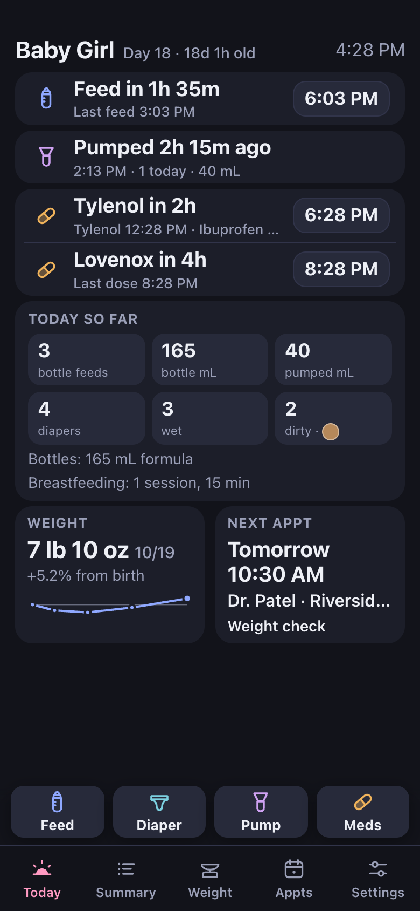
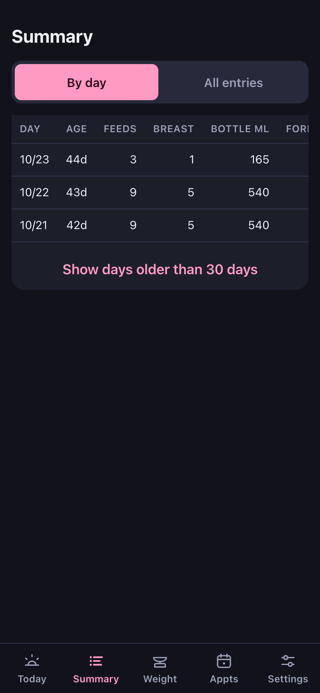
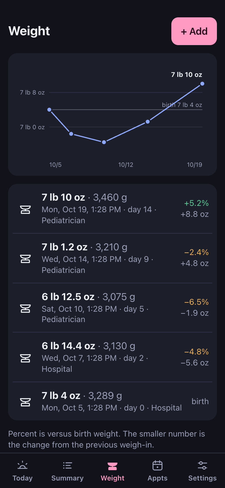

<h1 align="center"><br>bébé tracker</h1>

when our daughter was born we kept track of everything on a sheet of paper on the kitchen counter. feeds, diapers, pumping, and my wife's meds. two tired people, one pen, and a lot of "wait, when did she last eat?"

so this is the app version. we built it in the first week home, and it only does the logging part:

- feeds: bottles (formula, breast milk or mixed) in mL or oz, breastfeeds with side and minutes, and a countdown to the next one
- diapers: wet, dirty or both, with stool colour
- pumping: when, how much, and how many today
- mom's meds: countdowns from the intervals on the discharge sheet, or just "last taken" once she's weaning off. it switches off entirely when you're done
- weight in pounds and ounces, with a chart since birth
- appointments, with the next one on the home screen
- a summary table with one row per day, the numbers the pediatrician asks for

both phones see the same log within a second, it works offline, it installs to the home screen, and the main screen fits without scrolling so you can use it one-handed at 3 am.

**try it at [bebe.fyi](https://bebe.fyi)**, or poke around [the demo](https://bebe.fyi/demo) first (a made-up baby, nothing is saved). there's also a short [guide](https://bebe.fyi/guide/) and the [release notes](https://bebe.fyi/notes/).

<p align="center">
  
  
  
</p>

## what it doesn't do

it's a logbook, not a medical device. no targets, no thresholds, no "is this normal?", no dosing. med intervals start blank and you type them in from your own discharge papers. no accounts, no ads, no analytics.

## your data

there are no accounts. your household lives at a long private link, and that link is the key, so anyone who has it can read and change your log. share it with your partner and nobody else.

settings exports every entry as csv and everything as json, and can delete the whole household when you're done with it.

## running your own

you'll need node and a free firebase project (firestore + hosting, no billing).

```bash
npm install
npm run dev
```

to put it online:

1. create a firebase project, add a web app, and create a firestore database
2. put your project's web config in `src/firebase.ts` and your project id in `.firebaserc`
3. `npm run deploy` (hosting and the firestore rules)

`npm test` runs the tests for the parts that matter (day boundaries and daylight saving, daily totals, timers, units).

## built with

react, vite and typescript, plain css, vite-plugin-pwa, firebase (firestore and hosting), and [nunito](https://github.com/googlefonts/nunito) for the wordmark.

## license

[MIT](LICENSE)
